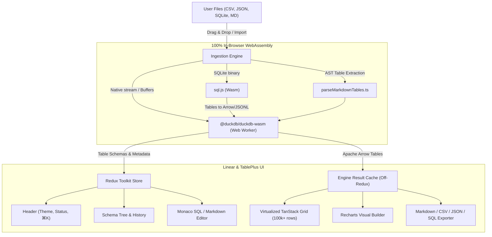

<div align="center">
  <picture>
    
  </picture>
  <h1>DataLoom</h1>
  <p><strong>100% Client-Side, Local-First In-Browser SQL, Large JSON/CSV & Markdown Visual Explorer</strong></p>
  <p>Crafted with the polish and performance of Linear, Raycast, and TablePlus.</p>
  
  <p>
    <a href="https://dataloom.sohagsheik.com" target="_blank">
      
    </a>
  </p>

  <p>
    
    
    
    
    
  </p>
</div>

---

## 🌐 Live Application

Experience DataLoom live directly in your browser:
👉 **[https://dataloom.sohagsheik.com](https://dataloom.sohagsheik.com)**

*(No sign-ups, no tracking, 100% local WebAssembly processing in your browser)*

---

## ⚡ Overview

**DataLoom** is a fast, local-first analytical workbench running completely inside your browser using **WebAssembly** and **Web Workers**. 

Zero data ever leaves your computer. No sign-ups, no cloud databases, no telemetry—just open the app, drag & drop your files, query them using fast SQL, clean data without writing code, and visualize or export in seconds.

---

## ✨ Features & Architecture

### 1. 📂 Multi-Format Ingestion (Zero-Upload & Offline)
- **`.csv` / `.tsv`**: Automatic delimiter sniffing, header detection, and type inference using DuckDB.
- **`.json` / `.jsonl` / `.ndjson`**: Ingest flat arrays or deeply nested JSON objects. Supports automatic recursive flattening into dot-notation columns (`user.address.geo.lat`).
- **`.sqlite` / `.db`**: Client-side SQLite database loading powered by in-memory `sql.js` (WebAssembly) with zero network dependency.
- **`.md` (Markdown Files)**:
  - Markdown AST extraction using `unified` + `remark-gfm`.
  - Automatically extracts all GFM markdown tables into queryable SQL tables (e.g. `readme_table_1`).
  - **Split Markdown Reader/Editor** mode with real-time sync, column reformatting, and live Markdown preview.
- **Built-in Sample Datasets**:
  - *E-Commerce Orders CSV* (1,500 rows with duplicates & formatting quirks to test cleaning)
  - *API Webhook Logs JSON* (400 nested payloads auto-flattened)
  - *Project Benchmarks Markdown* (Multi-table GFM document)
  - *100,000-Row Stress Table Generator* for testing 60fps virtual scrolling.

### 2. 💻 IDE-Grade SQL & Markdown Workbench
- **Multi-Tab Workspace**: Work on multiple SQL queries and Markdown documents side-by-side with keyboard navigation and middle-click tab closing.
- **Monaco Editor**:
  - Full SQL syntax highlighting.
  - **Schema-Aware Autocomplete**: Dynamically auto-completes table names, column names, DuckDB analytical functions, and SQL keywords straight from Redux state.
  - Formatter via `sql-formatter` (`Cmd/Ctrl + Shift + F`).
  - Explain query execution plans with 1-click.
- **Command Palette (`Cmd/Ctrl + K`)**:
  - Quick-switch tables, trigger exports, format SQL, change themes, or load sample datasets instantly.

### 3. 🚀 High-Performance Virtualized Data Grid
- Powered by `@tanstack/react-table` and `@tanstack/react-virtual`.
- Capable of rendering **100,000+ rows smoothly at 60fps** with low memory footprint.
- **Column Header Insights**:
  - Type-specific badges (`int`, `double`, `varchar`, `bool`, `time`, `json`).
  - Interactive sorting with null-safe comparators.
  - **Stats Popover**: Compute instant null counts, unique counts, min, and max values per column.
  - **Cell Inspector Drawer**: Click any long string, formatted JSON, or Markdown cell to slide out a Shadcn inspection sheet with 1-click copy.
- **No-Code Quick Transforms**:
  - Deduplicate rows (`SELECT DISTINCT *`)
  - Drop rows with `NULL`s
  - String operations: Trim whitespace, UPPER, lower, Title Case
  - Rename and drop columns

### 4. 📊 Data Visualization & Multi-Format Export
- **Theme-Aware Charts** (`recharts`):
  - 1-click switch between **Data Grid**, **Visual Chart**, **Markdown Preview**, and **Export**.
  - Auto-suggests categorical/date X-axis and numeric Y-axis.
  - Chart types: **Bar**, **Line**, **Area**, **Pie**, and **Scatter**.
- **Multi-Format Export**:
  - **Markdown Table (`.md`)**: GitHub-ready tables with right-aligned numeric columns.
  - **Clean CSV (`.csv`)**
  - **Formatted JSON (`.json`)**
  - **SQL `INSERT` statements (`.sql`)** with automatic schema creation.

### 5. 🎨 Linear / Raycast / TablePlus Aesthetics
- **Zero-Layout-Shift Theme System**: Light, Dark, and System modes syncing with `prefers-color-scheme`.
- Monospace typography with `@fontsource-variable/jetbrains-mono` and clean sans-serif UI with `@fontsource-variable/inter`.
- Resizable panels using `react-resizable-panels`.

---

## 🛠️ Tech Stack

| Component | Technology |
|---|---|
| **Framework** | React 18 + Strict TypeScript + Vite |
| **State Management** | Redux Toolkit (`@reduxjs/toolkit`, `react-redux`) |
| **SQL Engine** | `@duckdb/duckdb-wasm` (Dedicated Web Worker) |
| **SQLite Engine** | `sql.js` (WebAssembly, fully local) |
| **Editor** | Monaco Editor (`@monaco-editor/react`, local bundle) |
| **Data Grid** | `@tanstack/react-table` + `@tanstack/react-virtual` |
| **Markdown** | `unified` + `remark-parse` + `remark-gfm` + `react-markdown` |
| **Charts** | `recharts` |
| **Styling** | Tailwind CSS + Radix UI primitives + Lucide Icons |
| **Persistence** | `idb-keyval` (IndexedDB for query history & snippets) |

---

## 🏗️ Architecture & Data Flow



> **Why keep query results off Redux?**  
> Query results containing hundreds of thousands of rows are non-serializable and consume excessive memory if stored in Redux slices. DataLoom holds row buffers in an engine-side `resultStore` using `useSyncExternalStore`, while keeping query statuses, execution durations, and table schemas inside Redux.

---

## 🚀 Getting Started

### Prerequisites
- **Node.js**: v20 or newer
- **pnpm** (recommended) or **npm**

### Installation

```bash
# Clone the repository
git clone https://github.com/sohagsheik/dataloom.git
cd dataloom

# Install dependencies
pnpm install

# Start development server
pnpm dev
```

Visit `http://localhost:5173` in your browser.

### Building for Production

```bash
# Typecheck and build bundled static assets
pnpm build

# Preview production build locally
pnpm preview
```

### Running Tests

```bash
# Run unit tests via Vitest
pnpm test
```

---

## ⌨️ Keyboard Shortcuts

| Shortcut | Action |
|---|---|
| <kbd>Cmd/Ctrl</kbd> + <kbd>Enter</kbd> | Run selected SQL query (or full query) |
| <kbd>Cmd/Ctrl</kbd> + <kbd>K</kbd> | Open Command Palette |
| <kbd>Cmd/Ctrl</kbd> + <kbd>Shift</kbd> + <kbd>F</kbd> | Prettify / Format SQL query |

---

## 🔒 Privacy & Offline Guarantee

DataLoom does not communicate with any external backend API, analytical tracker, or cloud server. All DuckDB and Monaco WebAssembly binaries, workers, and web fonts are packaged locally. You can disconnect your internet connection and DataLoom will continue to function seamlessly.

---

## 📄 License

This project is licensed under the MIT License - see the [LICENSE](LICENSE) file for details.

Copyright (c) 2026 Sohag Sheik.
